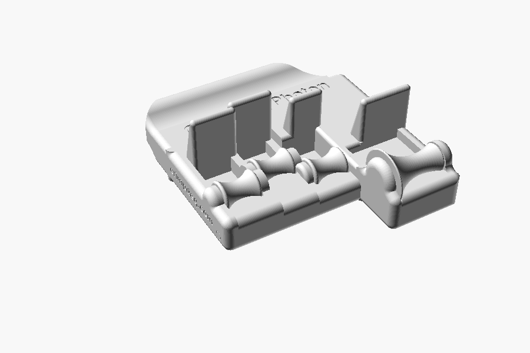

# Crimpdeq Grips

3D-printed grips for isolated finger training, as parametric OpenSCAD models: each finger rests
on its own roller. There are two grips:

- **Photon** targets the deep flexor (FDP), which bends the fingertip joint. In a claw grip,
  each fingertip rests on its roller under a block that holds its last joint.
- **Spark** targets the superficial flexor (FDS), which bends the middle joint. Each finger bends
  over a larger roller (22 to 40 mm), the middle joint level with its axis and the end joint on
  its top.

Both are fitted to your hand from a photo (optional for Spark). Every part prints in plastic, pins
included; the only extra is a cord.

- Book: fitting, printing and assembly at [grips.crimpdeq.com](https://grips.crimpdeq.com), source in
  [`docs/`](docs/src/SUMMARY.md) (`mdbook serve docs`).
- Hand measuring page: [grips.crimpdeq.com/measure-hand.html](https://grips.crimpdeq.com/measure-hand.html),
  source in [`docs/src/measure-hand.html`](docs/src/measure-hand.html); it measures a photo
  and downloads the STLs of Photon, Spark or both in a zip (served with the book:
  `python3 scripts/fetch_openscad_wasm.py`, then `mdbook serve docs`).
- Models: [`grips/`](grips/); export all parts of one hand with
  `python3 scripts/export.py photon PARAMS --hand right --out DIR`.
- STLs and Bambu Lab A1 projects (3MF) of both grips for both hands: attached to every
  [release](https://github.com/crimpdeq/crimpdeq-grips/releases); build a project from your own
  STLs with `python3 scripts/export_bambu_project.py DIR --output FILE.3mf`.

Based on [OpenGrips](https://github.com/opengrips/Open_Grips) and
[Jared-Is-Coding's fork](https://github.com/Jared-Is-Coding/Open_Grips), whose Prometheus v43 and
Sisyphus v27 STEP files the models rebuild as Photon and Spark. Released under [CC0](LICENSE).
