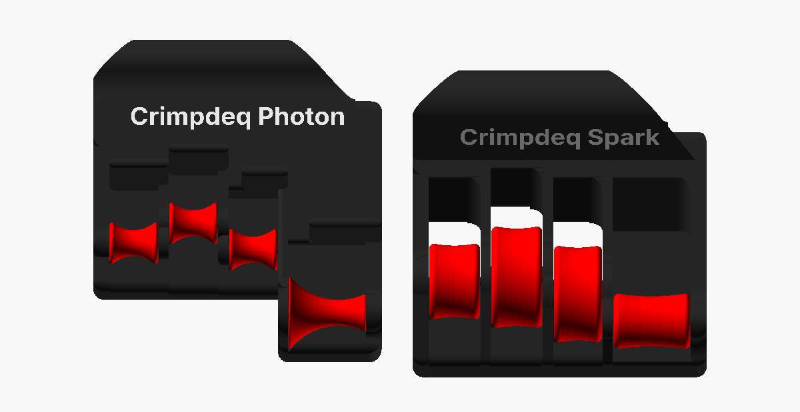

# Crimpdeq Grips

Crimpdeq Grips are 3D-printed grips for isolated finger training, all parametric OpenSCAD models.
In the two grips, each finger rests on its own roller:

- **Photon**: crafted specifically for your unique hand anatomy and optimized for targeted FDP
  training. In a claw grip, each fingertip rests on its roller under a block that holds its last
  joint.
- **Spark**: crafted specifically for your unique hand anatomy and optimized for targeted FDS
  training. Each finger bends over a larger roller (22 to 40 mm), the middle joint level with its
  axis and the end joint on its top.

[Measure a photo of your hand](measure-hand.html) to download parts that place every roller for
your fingers.

Every part, pins included, prints in the same plastic: no metal rods, screws or TPU. The only
extra is a cord through the anchor.

[**Mico**](mico/size.md) is a single printed part for mono (single finger) training: one finger
goes through its hole and a cord through its nose.

## Getting the parts

Each [release](https://github.com/crimpdeq/crimpdeq-grips/releases) attaches the STLs of both grips
for both hands, at the models' defaults, and a Bambu Studio project of each for the Bambu Lab A1;
Photon defaults to one measured right hand. Mico's STL and project are there too. To fit the grips
to your own hand, download the parts from the [measuring page](measure-hand.html).

## Credits

Photon and Spark build on [OpenGrips](https://github.com/opengrips/Open_Grips) and on
[Jared-Is-Coding's fork](https://github.com/Jared-Is-Coding/Open_Grips), whose Prometheus v43 and
Sisyphus v27 STEP files the OpenSCAD models rebuild as Photon and Spark. Like them, this project is
released under CC0.

All illustrations are rendered from the OpenSCAD models, so they match the exported parts.
