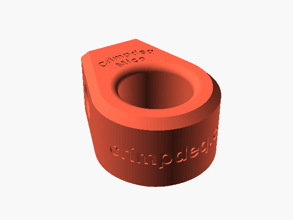

# Size and cord



Mico is one printed part for mono (single finger) training: the finger goes through the round
hole and a cord through the hole across the nose. It is 25 mm high, so the finger rests on a 20 mm
straight band whose rims are rounded by 2.5 mm.

## Finger hole

The hole is 22 mm across by default. For another size, set `Hole_Diameter` in a parameter file and
export Mico with it; the body and the nose grow or shrink with the hole, keeping their walls:

```sh
echo "Hole_Diameter = 24" > my-mico.txt
python3 scripts/export.py mico my-mico.txt
```

The STL goes to `exports/mico/mico.stl`. The same value is in OpenSCAD's Customizer (Window →
Customizer) when you open `grips/mico.scad`. The [measuring page](../measure-hand.html) does not
cover Mico.

## Cord

The cord hole is 8.5 mm across, with rounded edges where it leaves the sides of the nose.
