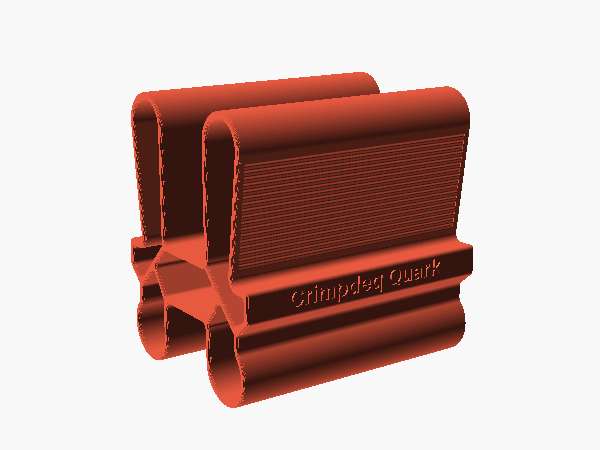

# Pinches and cord



Quark is one printed pinch block with four pinches. Its profile has two long arms and two short arms with round heads, on either side of a hollow hub, 115 mm
long. A lug on each side of the hub carries the engravings, and its flat ledge stops the fingers
on the long arms.

| Pinch | Hold | Across | Depth |
|---|---|---|---|
| Deep wide | Both long arms from outside | 73 mm at the ledge, 86 mm at the tips | 66 mm to the ledge |
| Deep narrow | One long arm, the thumb in the gap | 20.5 mm at the ledge, 27 mm at the tip | 62 mm to the gap's floor |
| Shallow wide | Both heads from outside | 90 mm | |
| Shallow narrow | One head, the thumb in the gap | 29 mm | 30 mm to the gap's floor |

The long arms widen toward their tips. Their outer faces, where the deep wide pinch holds, carry
shallow grip ridges (0.4 mm deep, 2.5 mm apart) running along the block, across the direction in
which the skin slips under load.

## Cord

The cord runs through the cells of both heads and stays there for all four pinches. Use about
1.6 m of 5 mm rated accessory cord: thread it through both heads and knot its two sides together
below the block. The cord bends over the ends of the head cells, whose edges are rounded.

Quark has not been load-tested. Build up the load gradually, and replace it if it whitens or
cracks, above all at the ends of the heads.

## Size

The gap between the arms of a side (`Gap`, 32 mm, room for the thumb), the depths of the gaps
(`Shallow`, 30 mm, and `Deep`, 62 mm) and the length (`Length`, 115 mm) are parameters. For other
values, set them in a parameter file and export Quark with it:

```sh
echo "Deep = 55" > my-quark.txt
python3 scripts/export.py quark my-quark.txt
```

The STL goes to `exports/quark/quark.stl`. The same values are in OpenSCAD's Customizer (Window →
Customizer) when you open `grips/quark.scad`. The engravings grow or shrink to fill the lugs' faces.
The [measuring page](../measure-hand.html) does not cover Quark.
