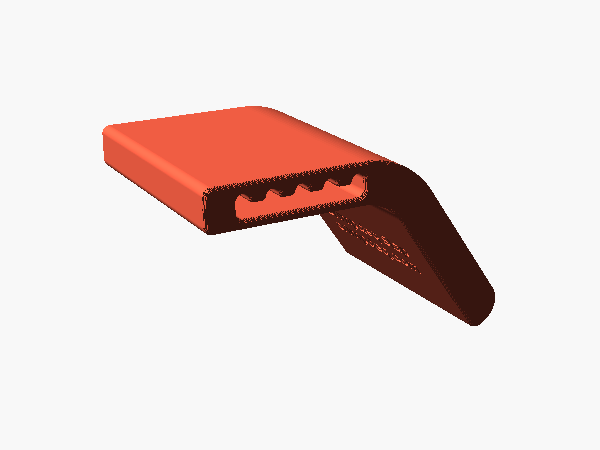

# Angles and cord



Slap is one printed sloper pump trainer: a bent bar, 90 mm wide and 16 mm thick, hung from a cord.
A short cord arm turns through a 55° bend into a longer gripped arm. Your hand goes over the
bend's convex outer face, a sloper with a 36 mm radius, and your fingers lie along the gripped arm.

## Cord and angles

A slot runs across the cord arm, from one end face to the other, with five notches along its top.
Use about 1.5 m of 4 mm rated accessory cord. Thread it through the slot and knot its two sides
together above Slap. Under load, the cord settles into one of the notches, and that notch sets the
hanging angle. To change the angle, unload Slap and slide the cord along the slot to another notch.

The farther the notch from the bend, the more the bar tilts under your hand, and the steeper the
sloper: the notch nearest the bend is the easiest angle, the one nearest the cord arm's tip the
hardest.

The cord bends over the ends of the slot, whose edges are rounded. Slap has not been load-tested.
Build up the load gradually, and replace it if it whitens or cracks, above all around the slot.

## Sandpaper

The printed outer face is too smooth to hold as a sloper: Slap needs sandpaper on it for
friction. Use a fine grit, around P220, cut to 90 × 157 mm, and glue it over the outer face from
the cord arm's tip down the gripped arm, clamping it around the bend while the glue sets.
OpenSCAD reports the sheet's size when it renders the model with other values. Replace the
sheet when it wears smooth or starts to peel.

## Size

The width (`Width`, 90 mm, across the fingers) and the bend (`Bend_Angle`, 55°, between the two
arms' directions) are parameters. For other values, set them in a parameter file and export Slap
with it:

```sh
echo "Width = 80" > my-slap.txt
python3 scripts/export.py slap my-slap.txt
```

The STL goes to `exports/slap/slap.stl`. The same values are in OpenSCAD's Customizer (Window →
Customizer) when you open `grips/slap.scad`. The [measuring page](../measure-hand.html) does not
cover Slap.
