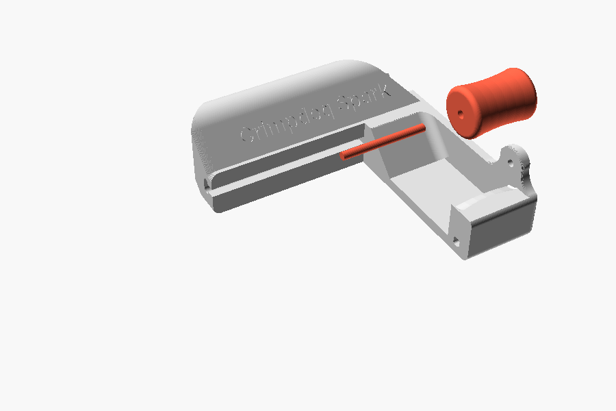
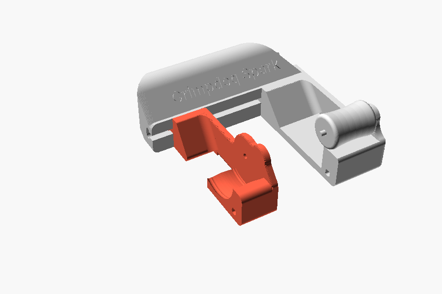
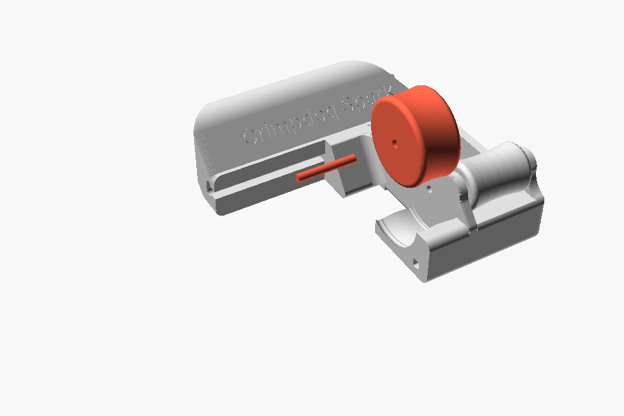
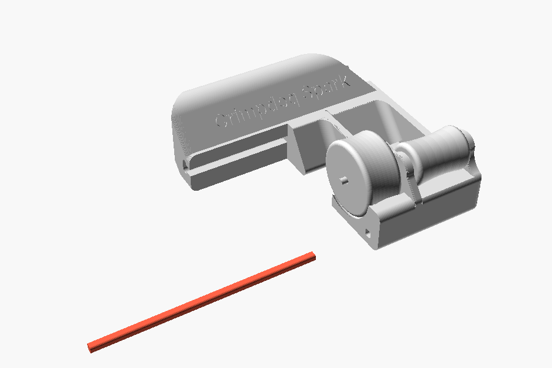
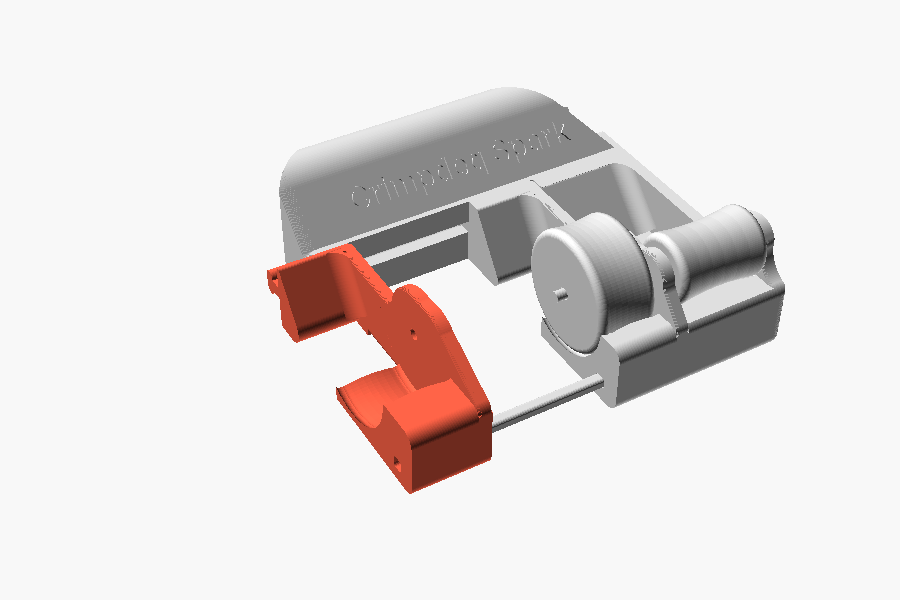
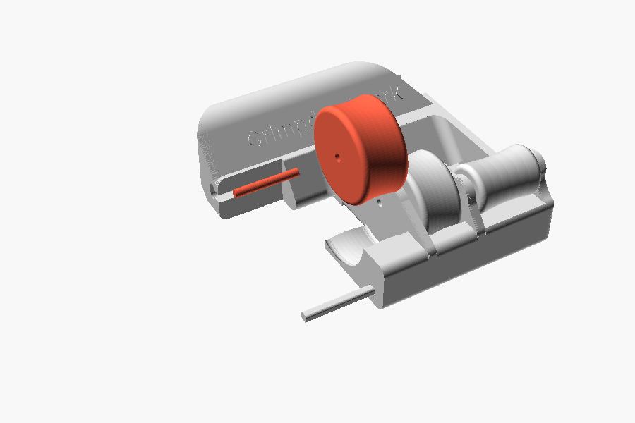
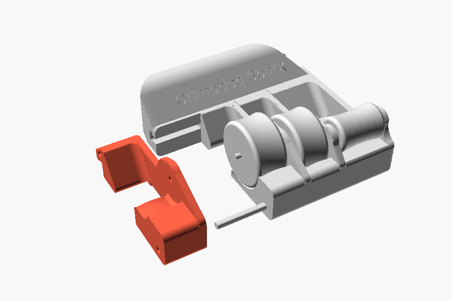
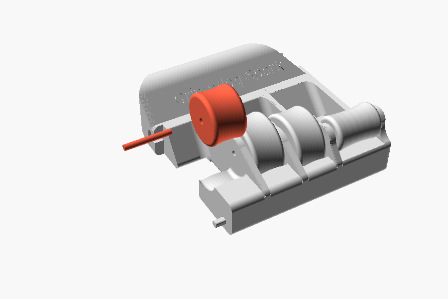
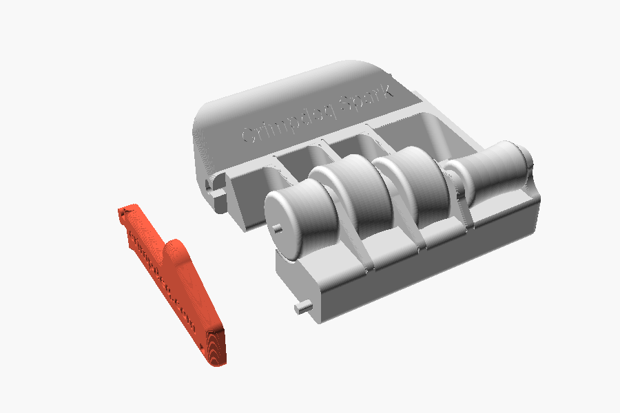
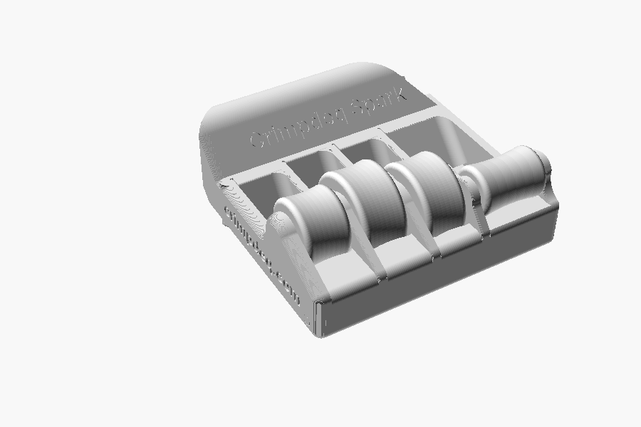

# Assembly

Build from the pinky side to the index side, in the same order as Photon. Walls slide into the
slot in the frame's crossbar from its open end, along the roller axis; they cannot drop in from
above. Each roller lies in the cradle of its wall, and each pin rests in a hole in the wall on both
sides of its roller.

Once together, the parts are hard to take apart without marring them: read the steps through
first and check each part's orientation before pushing it in. A little inert lubricant, such as
Super Lube, on the post and in the crossbar slot helps the parts slide in; wipe off the excess so
it does not get on your fingers.

## 1. Pinky roller and pin

Lay the pinky roller in the frame's cradle. Push the long pin through it into the frame's hole;
about 3 mm sticks out.

## 2. Ring wall

Slide the ring wall into the crossbar slot and push it along until the pinky pin enters its hole
and the wall sits against the roller.

## 3. Ring roller and pin

Lay the ring roller in the ring wall's cradle and push the ring pin, the shortest one, through it
into the wall.

## 4. Post

Install the post now: pushed through more walls later, it can hardly go in without breaking.
Turn it so its chamfered corner matches the corner of the square hole, and push it through the
ring wall into the frame as far as it goes. The rest sticks out and guides the next walls.

## 5. Middle wall

Slide it into the crossbar slot and onto the post at the same time, and push it onto the ring pin.
From here on, tap each wall home with the mallet over the wood block, alternating between its
crossbar end and its post end so it goes in straight.

## 6. Middle roller and pin

## 7. Index wall

## 8. Index roller and pin

## 9. End wall

Slide it in last, onto the index pin and the post, engraving facing out. The post ends flush with
it.

## 10. Cord

Thread the cord through the anchor's tube, behind the crossbar.

## If something does not fit

- The wall tongues fit their slot with no clearance. With lubricant and careful taps, a wall goes
  in even when it seems too tight. If one still will not move, sand its tongue instead of forcing
  it, or reprint the walls and the post slightly scaled down; keep the frame at full size.
- Pins, rollers and the post have clearance: every roller should spin freely and nothing should
  rattle.
- Finally, hold the grip: each finger should bend over its roller with the end joint on its top
  and the fingertip against the stop behind it.
