# Parts

How to put together a printed Spark grip. The pictures show the right-hand grip at the
model's defaults; a left-hand grip is its mirror image and goes together the same way.

You need the 14 printed parts, a cord for the anchor, a mallet or hammer with a small wood block,
and optionally an inert lubricant such as Super Lube.

The ring, middle and index walls look alike: label them as you take them off the plate (the
slicer's object list names every part). Each wall's cradle matches its roller.

| Part | | How to recognize it |
|---|---|---|
| Frame | 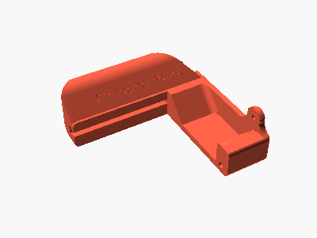 | The largest part, with the anchor's sloped bar engraved `Crimpdeq Spark` and the cord tube |
| Ring wall | 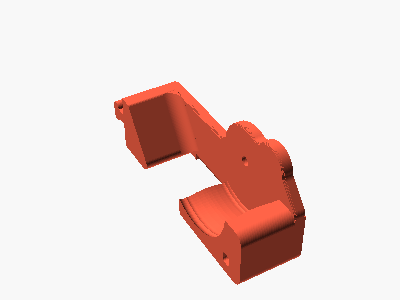 | Cradle for the 38 mm roller |
| Middle wall | 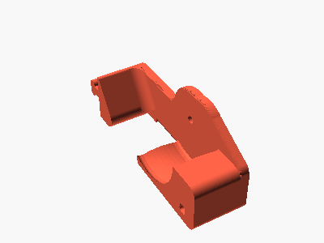 | Cradle for the 40 mm roller |
| Index wall | 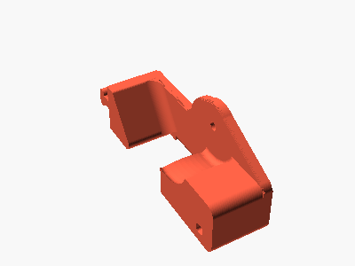 | Cradle for the 30 mm roller |
| End wall | 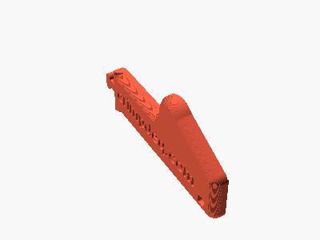 | Thin plate engraved `crimpdeq.com` |
| Pinky roller | 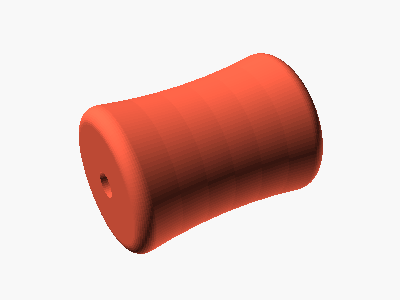 | 22 mm, the smallest and longest |
| Ring roller |  | 38 mm |
| Middle roller | 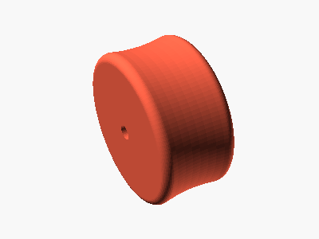 | 40 mm, the largest |
| Index roller | 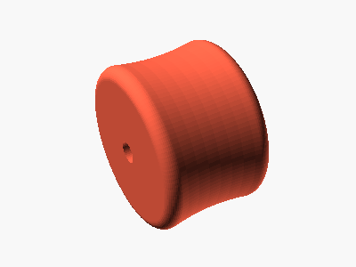 | 30 mm |
| Pinky pin | 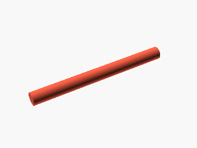 | The longest pin, about 36 mm |
| Ring pin |  | About 25 mm, 1 mm shorter than the middle and index pins |
| Middle and index pins (2) | 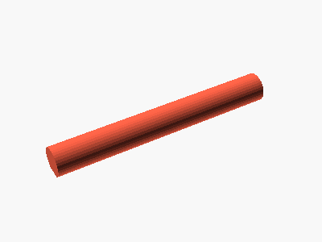 | About 26 mm, interchangeable |
| Post | 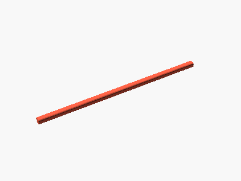 | Long square bar, about 105 mm, one corner chamfered |

The illustrations come from the OpenSCAD model; regenerate them with `docs/illustrations/render.sh`.
